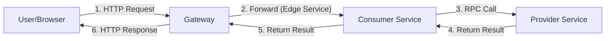
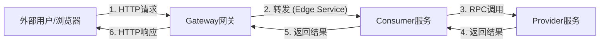

# basic-application(tomcat)

## Description

This project providers sample to show working with Java Chassis Microservices.

- **provider**:
  A Microservice using Java Chassis with a REST interface.
  Provider is packaged as WAR and deploy in tomcat.

- **consumer**:
  A Microservice using Java Chassis with a REST interface.
  Consumer calls provider with RPC.
  Consumer is packaged as WAR and deploy in tomcat.

- **gateway**:
  A Microservice using Java Chassis Edge Service to forward requests to consumer.
  Gateway packaged as executable JAR.

## Precondition

see [Precondition](../README.md)

## Build and Run

1. Build

   ```bash
   mvn clean package
   ```

2. Run provider

   Deploy `basic-provider-3.0-SNAPSHOT.war` to tomcat.

3. Run consumer

   Deploy `basic-consumer-3.0-SNAPSHOT.war` to tomcat.

4. Run gateway

   In `${Project}/gateway/target/`

   ```bash
   java -jar basic-gateway-3.0-SNAPSHOT.jar
   ```

5. Testing

   After starting the 3 microservices, access them through the interface:

    1. http://localhost:9090/sayHello?name=World
    2. http://localhost:9090/exampleConfig
   
   > You can add or modify the `provider` configuration `basic.example` in the configuration center / `application.yml`,
   > to test its priority and reading.

> **Note:** When running `provider` and `consumer` directly via the main class, you need to configure the Spring Boot embedded Tomcat port `server.port`.

## Call Chain



## 项目说明

这个项目提供了 Java Chassis 的简单例子，例子包括：

- **provider**：
  使用 Java Chassis 开发一个 REST 接口。 Provider 打包为 WAR 在 tomcat 部署。

- **consumer**：
  使用 Java Chassis 开发一个 REST 接口， 接口实现通过 RPC 调用 provider 的接口。 Consumer 打包为 WAR 在 tomcat 部署。

- **gateway**：
  使用 Java Chassis Edge Service 开发一个网关， 网关将所有请求转发到 consumer。 Gateway 打包为可执行 JAR 运行。

## 使用

1. 编译

   ```bash
   mvn clean package
   ```

2. 启动 provider

   将`basic-provider-3.0-SNAPSHOT.war`部署到 Tomcat。

3. 启动 consumer

   将`basic-consumer-3.0-SNAPSHOT.war`部署到 Tomcat。

4. 启动 gateway

   进入目录 `${Project}/gateway/target/`

   ```bash
   java -jar basic-gateway-3.0-SNAPSHOT.jar
   ```

5. 测试

   启动 3 个微服务后， 然后通过界面访问：

    1. http://localhost:9090/sayHello?name=World
    2. http://localhost:9090/exampleConfig
   
   > 可在配置中心/ `application.yml` 新增或修改 `provider` 的配置 `basic.example`，
   > 测试其优先级以及读取。

> 注：通过启动类直接运行 `provider` 和 `consumer` 需要配置 Spring Boot 内嵌 Tomcat 端口 `server.port`。

## 调用链


