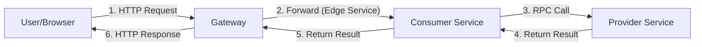

# basic-application

## Description

This project providers sample to show working with Java Chassis Microservices.

- **provider**:
  A Microservice using Java Chassis with a REST interface.

- **consumer**:
  A Microservice using Java Chassis with a REST interface. Consumer calls provider with RPC.

- **gateway**:
  A Microservice using Java Chassis Edge Service to forward requests to consumer.

## Precondition

see [Precondition](../README.md)

## Build and Run

1. Build

   ```bash
   mvn clean package
   ```

2. Run provider

   In `${Project}/provider/target/`

   ```bash
   java -jar basic-provider-3.0-SNAPSHOT.jar
   ```

3. Run consumer

   In `${Project}/consumer/target/`

   ```bash
   java -jar basic-consumer-3.0-SNAPSHOT.jar
   ```

4. Run gateway

   In `${Project}/gateway/target/`

   ```bash
   java -jar basic-gateway-3.0-SNAPSHOT.jar
   ```

5. Testing

   After starting the 3 microservices, access them through the interface:

    1. http://localhost:9090/sayHello?name=World
    2. http://localhost:9090/exampleConfig
   
   > You can add or modify the `provider` configuration `basic.example` in the configuration center / `application.yml`,
   > to test its priority and reading.

## Call Chain



## 项目说明

这个项目提供了 Java Chassis 的简单例子，例子包括：

- **provider**：
  使用 Java Chassis 开发一个 REST 接口。

- **consumer**：
  使用 Java Chassis 开发一个 REST 接口， 接口实现通过 RPC 调用 provider 的接口。

- **gateway**：
  使用 Java Chassis Edge Service 开发一个网关， 网关将所有请求转发到 consumer。

## 前置条件

参见[前置条件](../README.md)

## 使用

1. 编译

   ```bash
   mvn clean package
   ```

2. 启动 provider

   进入目录 `${Project}/provider/target/`

   ```bash
   java -jar basic-provider-3.0-SNAPSHOT.jar
   ```

3. 启动 consumer

   进入目录 ${Project}/consumer/target/

   ```bash
   java -jar basic-consumer-3.0-SNAPSHOT.jar
   ```

4. 启动 gateway

   进入目录 ${Project}/gateway/target/

   ```bash
   java -jar basic-gateway-3.0-SNAPSHOT.jar
   ```

5. 测试

   启动 3 个微服务后， 然后通过界面访问：

    1. http://localhost:9090/sayHello?name=World
    2. http://localhost:9090/exampleConfig
   
   > 可在配置中心/ `application.yml` 新增或修改 `provider` 的配置 `basic.example`，
   > 测试其优先级以及读取。

## 调用链


